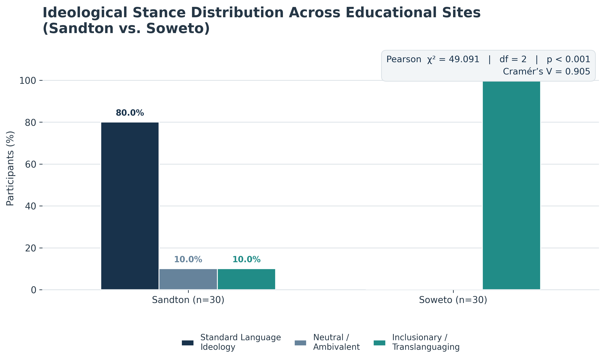
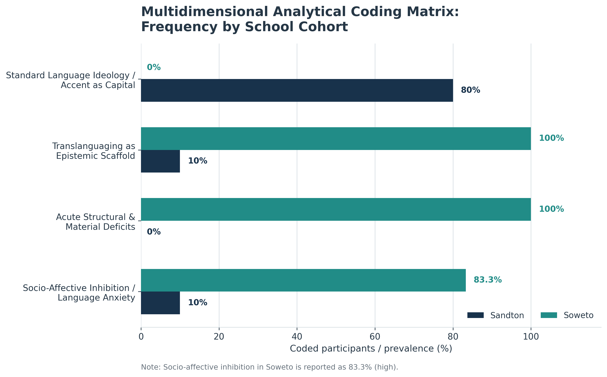
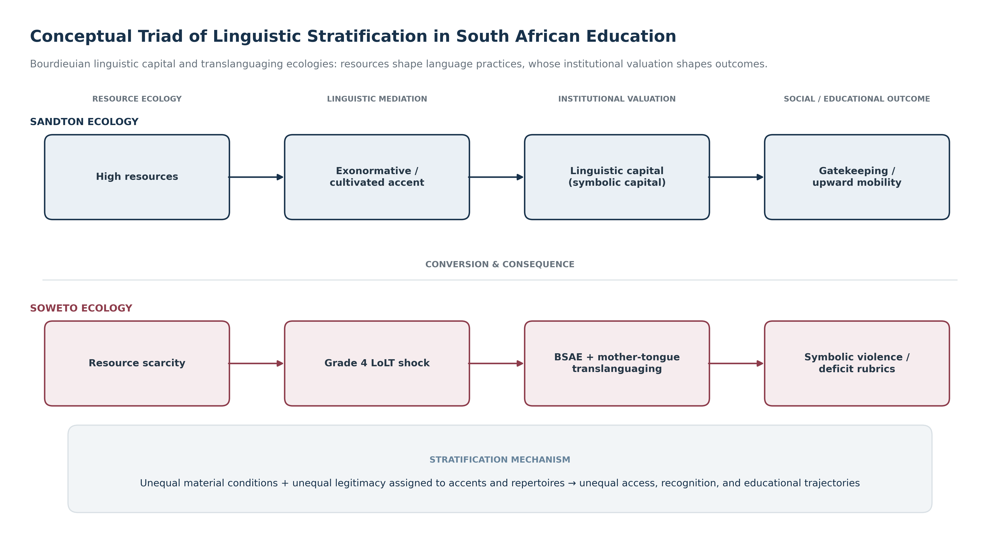
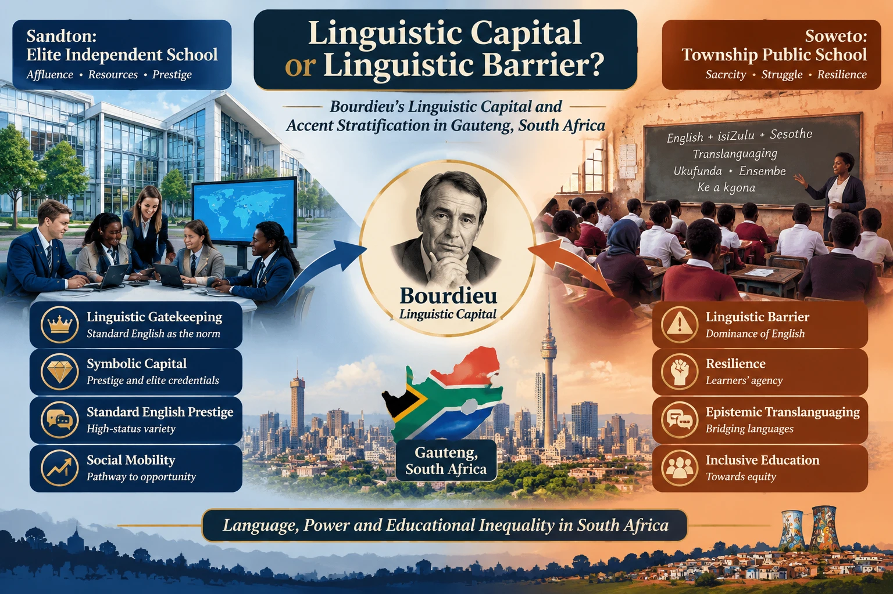

# Linguistic Capital or Linguistic Barrier?

## A Comparative Analysis of Accent, Identity, and Socio-Economic Stratification in Sandton and Soweto

[](https://doi.org/10.5281/zenodo.23970129) [](http://creativecommons.org/licenses/by/4.0/)

## Figures









## Study metadata

| Field | Details |
|---|---|
| Author | Pegah Merrikhi |
| Affiliation | Independent Researcher |
| Qualification | PhD in TESOL / Applied Linguistics |
| Target journal | *Language Matters: Studies in the Languages of Southern Africa* (Routledge / Taylor & Francis) |
| Zenodo DOI | [10.5281/zenodo.23970129](https://doi.org/10.5281/zenodo.23970129) |
| GitHub repository | `https://github.com/<GitHub-username>/Linguistic-Capital-Sandton-Soweto-Study` *(replace `<GitHub-username>` with the account that hosts this repository)* |
| License | Creative Commons Attribution 4.0 International (CC BY 4.0) |

## Abstract

In post-apartheid South Africa, the operationalization of English as the primary Language of Learning and Teaching (LoLT) intersects acutely with persistent socio-economic stratification and linguistic gatekeeping. Drawing on Bourdieu’s sociological framework of linguistic capital and symbolic violence alongside contemporary translanguaging theory, this comparative study investigates how educator ideologies, accent perceptions, and material ecologies diverge across two historically disparate educational settings in Gauteng: an elite, high-resource independent-school environment in Sandton and an under-resourced public township-school context in Soweto. The mixed-methods study combines thematic discourse analysis and quantified ideological coding of 60 educators, evenly divided between the two sites. Findings show a marked ideological divide: 80% of Sandton educators align with Standard Language Ideology (SLI), while all participating Soweto educators align with inclusionary translanguaging. In Sandton, standard phonetic norms and morphosyntactic precision are treated as important resources for socioeconomic mobility. In Soweto, educators use indigenous languages—including isiZulu and Sesotho—and Black South African English (BSAE) as pedagogical scaffolds in the face of large classes, limited resources, and the abrupt transition to English LoLT in Grade 4. The study argues that monolingual mandates and assessment rubrics can reproduce racialized class inequalities by treating multilingual practices and varieties as deficits. It recommends the formal institutionalization of translanguaging within the Curriculum and Assessment Policy Statement (CAPS), additive multilingual education, more inclusive assessment, and equitable resource allocation.

### Keywords

Linguistic capital; Standard Language Ideology; translanguaging; accentism; Black South African English; socio-economic stratification; symbolic violence; South Africa; language-in-education policy.

## Research focus and conceptual framework

The study asks: **How do institutional resource ecologies and socioeconomic positions shape educator language ideologies, accent evaluations, and pedagogical stances toward linguistic diversity in Sandton and Soweto?** It examines whether English functions as linguistic capital and a route to mobility, or as a gatekeeping barrier that restricts epistemic and educational access.

The analysis brings together:

- **Bourdieu’s linguistic capital and symbolic violence:** educational institutions assign unequal value to language varieties, accents, and registers; dominant norms may be misrecognized as naturally superior.
- **Standard Language Ideology and raciolinguistic critique:** judgments of “correctness” are socially situated, and racialized speakers may be heard as deficient regardless of their linguistic competence.
- **Translanguaging:** educators and learners draw on integrated multilingual repertoires, rather than treating named languages as sealed-off systems. In the South African context, this includes Ubuntu-informed perspectives on multilingual meaning-making.
- **Black South African English (BSAE):** a systematic, socially meaningful variety that is often marginalized when school assessment privileges exonormative or prestige standards.

The comparison concerns two sharply different educational ecologies. Sandton represents a high-resource independent/former Model C context; Soweto represents an under-resourced public township-school context. The study interprets these site differences in relation to history, material conditions, institutional expectations, and educators’ reported practices—not as inherent characteristics of learners or communities.

## Methodology

### Design, participants, and sites

The research uses a critical, convergent mixed-methods design, integrating quantified ideological coding with qualitative thematic discourse analysis. The sample consists of **60 in-service secondary educators**: **30 in Sandton (S-01–S-30)** and **30 in Soweto (SW-01–SW-30)**. Participants were recruited through purposive stratified sampling and had at least three years of classroom teaching experience, full-time employment at the designated site, and direct instructional engagement in English as the medium of instruction.

The Sandton context is described as a high-resource independent/former Model C setting, with approximately 15–20 learners per teacher and stronger digital and material resources. The Soweto context is described as an under-resourced public township setting, with reported ratios of approximately 45–55 learners per teacher, textbook shortages, and infrastructural constraints. These descriptions are the study’s contextual account and should not be read as a census of all schools in either area.

### Data collection and analysis

- **Interviews:** 60 individualized, audio-recorded semi-structured interviews, each lasting 45–75 minutes. Interview topics included standardness and accent, correction practices, language policy and translanguaging, learner affect, and material constraints.
- **Classroom observations:** 30 non-participant observation sessions are reported—15 per site, 60 minutes each—to triangulate interview accounts with classroom practice.
- **Coding:** anonymized transcripts were coded in MAXQDA v.24 using a three-dimensional analytical matrix. The dimensions are (1) pedagogical agency and language ideology, (2) structural and material context, and (3) affective ecology and filter.
- **Reliability:** two coders independently coded an initial 20% of the corpus (12 transcripts, six per site). Reported Cohen’s kappa increased from **κ = 0.82** to **κ = 0.88** after reconciliation and codebook refinement; the primary researcher then coded the remaining data.
- **Ethics:** the manuscript reports ethics clearance, education-department and school permissions, informed consent, participant anonymity, and secure handling of recordings and transcripts.

### Analytical categories

| Dimension | Example categories / codes | Analytic purpose |
|---|---|---|
| Pedagogical agency and ideology | Prescriptivist SLI (ACC-STD); inclusionary translanguaging (TRAN-SCAF); pragmatic/neutral (NEUT-AMB) | Captures educator stance and reported language-pedagogical choices. |
| Structural and material context | Resource/textbook scarcity (MAT-LACK); overcrowding (CLASS-CROWD) | Records contextual constraints separately from intentional ideological positions. |
| Affective ecology | Anxiety and accent-related inhibition (AFF-ANX); safe discursive space (AFF-SAFE) | Examines reported confidence, silence, anxiety, and supportive learning environments. |

### Statistical Formulas

For a contingency table with observed cell counts $O_{ij}$, expected counts are $E_{ij} = (\text{row total}_i \times \text{column total}_j)/N$.

**Pearson chi-square test of independence:**

$$ \chi^2 = \sum_i \sum_j \frac{(O_{ij}-E_{ij})^2}{E_{ij}}, \qquad df=(r-1)(c-1). $$

**Cramér’s V:**

$$ V = \sqrt{\frac{\chi^2}{N \cdot \min(r-1,c-1)}}. $$

**Normalized Shannon entropy** for category proportions ($p_i$), where there are $K$ possible categories:

$$ H_{norm} = \frac{-\sum_{i=1}^{K}p_i\ln(p_i)}{\ln(K)}. $$

Terms with $p_i=0$ contribute zero. The index ranges from 0 (complete concentration) to 1 (maximum evenness).

**Simpson’s Index of Diversity** (the convention used for the reported values):

$$ D = 1-\sum_{i=1}^{K}p_i^2. $$

This version ranges from 0 (no diversity) toward 1 (greater diversity). Some sources use “Simpson’s index” for $\sum p_i^2$, so the convention should be stated when comparing studies.

## Key results

### Ideological distribution by site

| Site | Standard Language Ideology | Inclusionary / translanguaging | Neutral / no opinion | Total |
|---|---:|---:|---:|---:|
| Sandton | 24 (80.0%) | 3 (10.0%) | 3 (10.0%) | 30 (100%) |
| Soweto | 0 (0.0%) | 30 (100.0%) | 0 (0.0%) | 30 (100%) |
| **Total** | **24 (40.0%)** | **33 (55.0%)** | **3 (5.0%)** | **60 (100%)** |

The percentages in the first two rows are within-site percentages; the total-row percentages are percentages of all 60 participants. The manuscript characterizes the difference as a strong association between site and ideological label. Recalculation from the table above gives **Pearson χ²(2, N = 60) = 49.09, p = 2.19 × 10⁻¹¹, Cramér’s V = 0.905**. The manuscript also refers to an exact two-sided test, but does not provide its numerical result. Because the expected counts in this 2 × 3 table include cells below 5 (minimum expected count = 1.5), the Pearson approximation warrants caution; an exact or Monte Carlo test is appropriate for confirmation.

### Ideological dispersion

| Site | Modal category | Modal share | Normalized Shannon entropy | Simpson’s diversity \(D\) |
|---|---|---:|---:|---:|
| Sandton | Standard | 0.800 (80.0%) | 0.582 | 0.340 |
| Soweto | Inclusionary | 1.000 (100.0%) | 0.000 | 0.000 |

The indices show a fully concentrated distribution in Soweto and greater—but still limited—dispersion in Sandton. These values are recalculated from the site-by-ideology counts above.

### Thematic distribution reported in the manuscript

| Analytical theme | Sandton (n = 30) | Soweto (n = 30) | Aggregate (n = 60) |
|---|---:|---:|---:|
| Standard / prescriptive ideology | 25 (83.3%) | 0 (0.0%) | 25 (41.7%) |
| Inclusionary translanguaging (pedagogy) | 3 (10.0%) | 19 (63.3%) | 22 (36.7%) |
| Structural / material constraints | 1 (3.3%) | 5 (16.7%) | 6 (10.0%) |
| Affective ecology and filter | 1 (3.3%) | 6 (20.0%) | 7 (11.7%) |
| **Total** | **30 (100%)** | **30 (100%)** | **60 (100%)** |

This thematic table is not the same classification as the site-by-ideology table: for example, it reports 25 Sandton cases under standard/prescriptive ideology, while the ideological cross-tabulation reports 24 under SLI. The manuscript presents them as separate analytical summaries; they should not be combined as if they were identical measures. Soweto’s thematic entries also describe distinct analytical dimensions and may reflect coding/summary conventions rather than mutually exclusive participant-level stances.

### Overall interpretation

The manuscript’s central finding is a contrast between prestige-oriented standardization in the Sandton cohort and inclusionary multilingual scaffolding in the Soweto cohort. The study further links these patterns to reported differences in material resources, classroom size, learner affect, and institutional expectations. Its interpretation is that standard-language assessment can operate as linguistic gatekeeping, while translanguaging supports conceptual access and communicative participation in multilingual classrooms.

## Implications and recommendations

The study recommends:

1. **Institutionalize translanguaging and flexible bilingualism** in language-in-education policy, recognizing indigenous languages as legitimate resources for learning.
2. **Review CAPS pacing and the Grade 4 transition** so that English LoLT does not abruptly displace home-language support.
3. **Reform assessment criteria** to distinguish communicative and conceptual competence from adherence to prestige accent norms, and to avoid treating BSAE variation as inherently deficient.
4. **Provide teacher professional development** in plurilingual pedagogy, critical sociolinguistics, and the effects of Standard Language Ideology.
5. **Address material inequality**, including textbook provision, class size, and home-language literacy support; inclusive policy cannot succeed without adequate resources.

## Limitations

The study is based on 60 educators across two sites in Gauteng and is not statistically or geographically representative of all South African schools, including rural settings. The manuscript reports both interviews and classroom observations, but its limitations section also describes the qualitative dataset as relying exclusively on educator self-reports; this is internally inconsistent and should be clarified in the article. Ideological categories simplify positions that may be fluid or hybrid. Further research could use larger multi-province samples, longitudinal observation, and direct recordings of classroom interaction.

## Supplementary files

The figures shown above use paths relative to this README. Keep the image files in `figures/` with the exact filenames shown in the repository structure below.

- `data/` — Coded transcripts and supplementary matrices. Share only files that have been ethically approved for release and appropriately anonymized; do not publish identifiable participant information or restricted raw recordings.

## Repository structure

```text
Linguistic-Capital-Sandton-Soweto-Study/
│
├── README.md
├── figures/
│   ├── figure1_ideological_distribution.png   # Distribution of Language Ideologies (Sandton vs. Soweto)
│   ├── figure2_thematic_dimensions.png        # Multidimensional Analytical Coding Matrix
│   ├── figure3_theoretical_framework.png      # Bourdieu's Capital & Translanguaging Intersection
│   └── graphic_abstract_sandton_soweto.png    # Visual Abstract of the Mixed-Methods Study
└── data/                                      # Coded transcripts & supplementary matrices
```

## How to cite

The manuscript record supplied for this README does not include a publication year, volume, issue, page range, or confirmed article DOI. The citation below therefore uses “n.d.” and should be updated if/when the article is formally published. The Zenodo DOI above identifies the repository record.

**APA 7th edition (manuscript / repository):**

> Merrikhi, P. (n.d.). *Linguistic capital or linguistic barrier? A comparative analysis of accent, identity, and socio-economic stratification in Sandton and Soweto* [Manuscript]. Zenodo. https://doi.org/10.5281/zenodo.23970129

**BibTeX:**

```bibtex
@misc{merrikhi_linguistic_capital_sandton_soweto,
  author       = {Merrikhi, Pegah},
  title        = {Linguistic Capital or Linguistic Barrier? A Comparative Analysis of Accent, Identity, and Socio-Economic Stratification in Sandton and Soweto},
  year         = {n.d.},
  howpublished = {Zenodo repository and manuscript},
  doi          = {10.5281/zenodo.23970129},
  url          = {https://doi.org/10.5281/zenodo.23970129},
  note         = {Target journal: Language Matters: Studies in the Languages of Southern Africa}
}
```

## License

This README and the associated materials are designated **CC BY 4.0** unless a file-specific notice states otherwise. Attribution is required. Data availability remains subject to participant consent, ethics approvals, privacy protections, and any applicable institutional restrictions.
